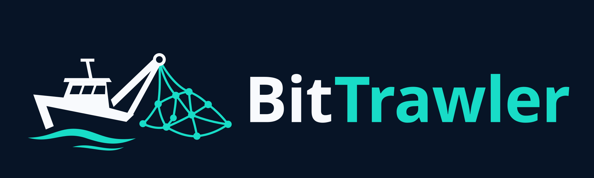
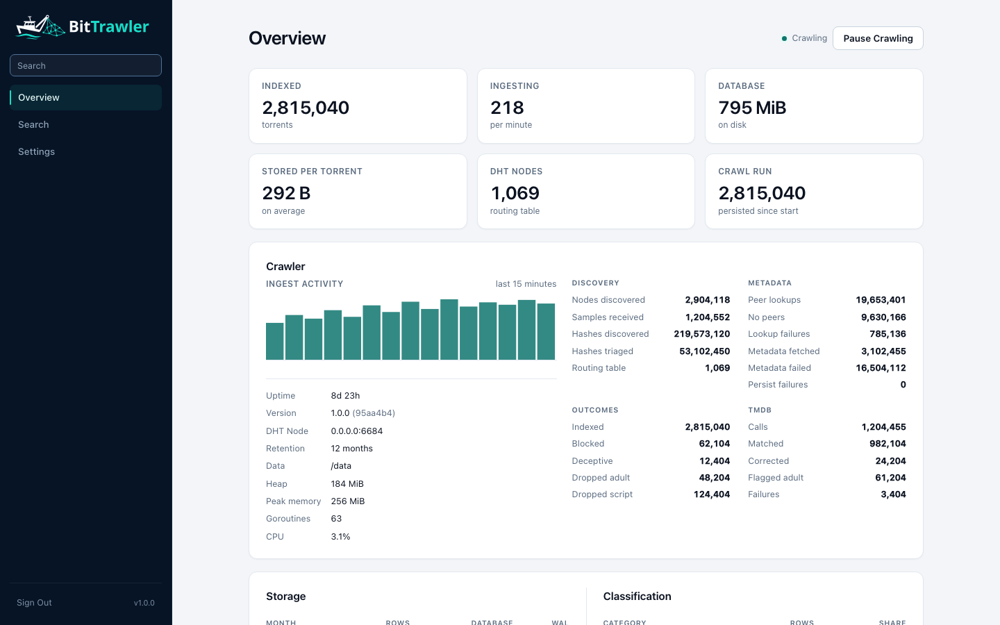

# BitTrawler

A self-hosted BitTorrent indexer and DHT crawler, designed for automated use through Prowlarr, Sonarr and Radarr. It crawls DHT to find new torrents without requiring any centralised infrastructure. Torrents are automagically classified and served to compatible tools through Torznab.

BitTrawler is loosely based on [bitmagnet](https://github.com/bitmagnet-io/bitmagnet). It came about because bitmagnet has a number of structural defects in searching, file usage and classification which couldn't realistically be fixed by a PR. By starting almost completely from scratch, we have been able to make controversial design decisions like moving to SQLite. These design choices have ultimately allowed us to reduce file usage by 95% and considerably improve the accuracy of searching and classification.

As of this public release (v1), BitTrawler is feature complete. You can deploy it, connect it up to Prowlarr and it just works. 

## Features
- Trawl the DHT network and gather up torrents
- Manually search against gathered torrents
- UI login system and API key for other apps
- Full torznab/prowlarr support (including accurate search results and series search results for sonarr)
- Partitioned DB (drop old data over time to prevent infinite growth)
- Automatically block illegal torrents such as CSAM
- Automatically block deceptive torrents such as malware disguised as video files
- Automatically drop XXX torrents (optional)
- Automatically drop torrents titled only in foreign scripts (optional)
- Automatically categorise torrents by looking at file features, titles, known XXX performer names etc
- Configure everything within the app, no text files required!
- Start/stop trawling within the app

## Screenshot
<picture>
  <source media="(prefers-color-scheme: dark)" srcset="assets/screenshots/overview-dark.png">
  
</picture>

## Quick start

BitTrawler should generally be deployed using docker for convenience. An example compose file is available here: [deploy/docker-compose.yml](deploy/docker-compose.yml). 

It is recommended that you run BitTrawler through a VPN using gluetun to avoid linking your home IP address to torrent activity. An example is available here: [deploy/docker-compose.gluetun.yml](deploy/docker-compose.gluetun.yml)


**Steps:**

1. Create the data directory.

   ```sh
   sudo mkdir -p /srv/bittrawler
   sudo chown 1000:1000 /srv/bittrawler
   ```

2. Copy the compose file to the Docker host and set the volume path. It points at `ghcr.io/bittrawler/bittrawler:latest`, which tracks the newest release:

   ```yaml
   image: ghcr.io/bittrawler/bittrawler:latest
   ```

3. Start it:

   ```sh
   docker compose up -d
   docker compose logs -f
   ```

4. Open `http://<host>:6684/`. You will see the setup page where you can set up your administrator account. 

Port 6684/tcp is used to serve the web UI and Torznab. Port 6684/udp is used for DHT. If you are using gluetun, you will need to add those ports to its list.

If you don't want to use docker, static binaries are published for Linux, macOS and Windows on amd64 and arm64. [deploy/systemd/bittrawler.service](deploy/systemd/bittrawler.service) can be used to run the binary on a Linux host as a dedicated account that can write only to `/var/lib/bittrawler`.

## First run

The first time you run BitTrawler it will ask you for an administrator username and password, and an optional TMDB token. If a TMDB API key is provided, BitTrawler will check possible TV and Film torrents against TMDB, improving classification and search accuracy.

BitTrawler doesn't use configuration files, all settings are configured within the web interface.

## Prowlarr, Sonarr and Radarr

Add a Torznab indexer with the URL and API key shown on the settings page:

| Field | Value |
|---|---|
| URL | `http://<host>:6684` |
| API path | `/torznab/api` |
| API key | the key shown by the instance |

Once added to Prowlarr, BitTrawler will respond to requests from Sonarr and Radarr. It fully supports both season and episode searches and reliability is considerably improved compared to bitmagnet. 

## Retention and disk usage

BitTrawler uses SQLite and is heavily optimised to reduce file usage and disk wear compared to bitmagnet. Real-world testing averages 292 bytes per torrent, so 10m torrents is less than 3GB, compared to 65GB+ for bitmagnet. Disk wear is also a big issue in bitmagnet, with over 1MB in disk writes every single time a torrent is crawled, so BitTrawler has been designed to use significantly fewer indexes with less fan-out to try and avoid this kind of excessive wear on your disks.

BitTrawler's database is partitioned by calendar month. By default it keeps 12 months of data before dropping the oldest month. Because each month is kept self-contained, deleting old data doesn't require anything like VACUUM to be run, it just deletes the file.

Set **Retention Months** to `0` if you want to keep everything.

## Commands
(If you don't use docker)

| Command | Description |
|---|---|
| `bittrawler run` | Crawl and serve. The default when no command is given. |
| `bittrawler doctor` | Check an installation and change nothing. Its port checks need the instance stopped. |
| `bittrawler healthcheck` | Exit successfully if a running instance answers. |
| `bittrawler version` | Print the build version, commit, build date and store schema. |
| `bittrawler auth reset` | Clear the administrator account and run setup again. |
| `bittrawler settings reset <key>` | Reset one stored setting to its default. |
| `bittrawler reclassify` | Re-run the classifier over stored rows. A dry run unless `-apply` is added; `-delete-rejected` removes newly blocked torrents from the database |

`run` accepts `-data` for the data directory, `-http` and `-dht` for the listen addresses, and `-log-level`.

## Licence

MIT. BitTrawler is derived from bitmagnet; the copied and adapted parts are listed in [NOTICE](NOTICE).

## Development

Contributions and feature requests are welcome. See [CONTRIBUTING.md](CONTRIBUTING.md) for more details.
